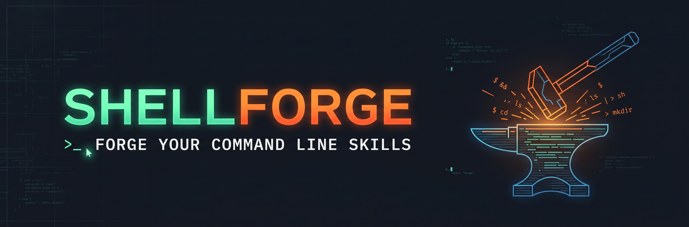

# Shellforge



[](https://github.com/jiahw4ng/shellforge/.github/workflows/ci.yml)
[](https://github.com/jiahw4ng/shellforge/blob/main/go.mod)
[](https://github.com/jiahw4ng/shellforge/blob/main/LICENSE)

Shellforge is an interactive, mission-based Bash learning tool written in Go.
Lessons run inside disposable, resource-limited Docker containers rather than on
the host filesystem.

## Requirements

- Go 1.26.5 or the version declared by `go.mod`.
- Docker Desktop or another reachable Docker engine.
- Docker configured to run Linux containers.
- An amd64 host for the currently supported native Windows and Linux/WSL paths.

## Windows (PowerShell)

Build the Linux sandbox image, compile the native Windows executable, and run it
from Windows Terminal or another compatible console:

```powershell
docker build --file docker/lesson.Dockerfile --platform linux/amd64 --tag shellforge-sandbox:0.1.0 .
New-Item -ItemType Directory -Force bin | Out-Null
go build -trimpath -ldflags="-s -w" -o bin\shellforge.exe .\cmd\shellforge
.\bin\shellforge.exe
```

If Docker Desktop is using Windows containers, switch it to Linux containers
before starting Shellforge. A binary built inside WSL is a Linux executable and
cannot be launched directly from PowerShell; use the native build command above.

## Linux or WSL 2

```bash
make sandbox-image
make build
./bin/shellforge
```

## Controls

Navigation screens use the arrow keys and Enter. Press F3 to show or hide the
available shortcuts.

Settings lets you choose the terminal cursor style (block, underline, or bar,
each blinking or steady). The choice is saved with your lesson progress.

During a lesson:

- F1 shows or hides revealed hints.
- F2 shows or hides progress checks, including pending tasks and the latest results.
- F3 shows or hides the full help view.
- F10 reveals the next hint.
- F12 runs the lesson's progress checks.
- Ctrl+P and Ctrl+N change lesson pages.
- PgUp and PgDn scroll the lesson guide.
- Ctrl+Alt+R restarts the lesson sandbox.
- Ctrl+D returns to the lesson list.

Function keys are passed through normally in the standalone sandbox.

NOTE: This project is still in early development! The full feature spec will be published in the future.
