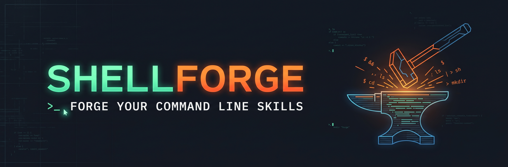

# Shellforge



[](https://github.com/jiahw4ng/shellforge/.github/workflows/ci.yml)
[](https://github.com/jiahw4ng/shellforge/blob/main/go.mod)
[](https://github.com/jiahw4ng/shellforge/blob/main/LICENSE)

Shellforge is an interactive, mission-based Bash learning tool written in Go.
Lessons run inside disposable, resource-limited Docker containers rather than on
the host filesystem.

## Requirements

- Docker Desktop or another reachable Docker engine, started before you run Shellforge.
- Docker configured to run Linux containers.
- A tested host: Windows (amd64) or Linux/WSL 2 (amd64).
- Experimental hosts: macOS (Apple Silicon or Intel) and Linux arm64. Release
  downloads exist for them, but they have not been tested on real hardware yet.
  The sandbox image is published for both amd64 and arm64, and Docker picks the
  one that matches your machine.
- Any other host can build from source (see below).

## Install

Download the archive for your system from the
[latest release](https://github.com/jiahw4ng/shellforge/releases/latest) along
with `checksums.txt`. Replace `<version>` below with the version in the file name.

**Windows (PowerShell)**

```powershell
# Check the download against checksums.txt; the two hashes must match.
(Get-FileHash .\shellforge_<version>_windows_amd64.zip -Algorithm SHA256).Hash
Select-String shellforge_<version>_windows_amd64.zip checksums.txt

Expand-Archive .\shellforge_<version>_windows_amd64.zip -DestinationPath shellforge
.\shellforge\shellforge.exe
```

The binary is not code-signed, so Windows may show a SmartScreen warning the
first time you run it. If Docker Desktop is using Windows containers, switch it
to Linux containers first.

**Linux or WSL 2**

```bash
sha256sum --check --ignore-missing checksums.txt
tar -xzf shellforge_<version>_linux_amd64.tar.gz
./shellforge
```

On arm64 Linux, use the `linux_arm64` archive instead.

**macOS (experimental)**

Use `darwin_arm64` on Apple Silicon or `darwin_amd64` on an Intel Mac.

```bash
# Compare this hash with the matching line in checksums.txt.
shasum -a 256 shellforge_<version>_darwin_arm64.tar.gz
grep darwin_arm64 checksums.txt

tar -xzf shellforge_<version>_darwin_arm64.tar.gz
xattr -d com.apple.quarantine shellforge
./shellforge
```

The binary is not notarized, so macOS blocks a downloaded copy until you run the
`xattr` line above (it may print "No such xattr" if the file was not flagged,
which is fine). Start Docker Desktop first.

Make sure Docker is running before you start a lesson. The first time you do,
Shellforge downloads the Linux sandbox image (`ghcr.io/jiahw4ng/shellforge-sandbox:0.1.4`)
automatically. This needs an internet connection once; later launches reuse the
downloaded image.

## Building from source

For contributors, or if you prefer to compile it yourself. This needs Go 1.26.5
or the version declared by `go.mod`.

**Windows (PowerShell)**

```powershell
New-Item -ItemType Directory -Force bin | Out-Null
go build -trimpath -o bin\shellforge.exe .\cmd\shellforge
.\bin\shellforge.exe
```

A binary built inside WSL is a Linux executable and cannot be launched directly
from PowerShell; use the command above.

**Linux or WSL 2**

```bash
make build
./bin/shellforge
```

The sandbox image is downloaded automatically on first use either way.

## Building the sandbox image yourself

Contributors changing the Dockerfile, or anyone working offline, can build the
image locally. It is tagged with the same name Shellforge looks for, so it is
used instead of downloading:

```bash
make sandbox-image
```

On Windows, run `docker build --file docker/lesson.Dockerfile --tag ghcr.io/jiahw4ng/shellforge-sandbox:0.1.4 .`.

## Controls

Navigation screens use the arrow keys and Enter. Press F3 to show or hide the
available shortcuts.

Settings lets you choose the terminal cursor style (block, underline, or bar,
each blinking or steady) and a color theme: Auto (the default, which picks
Light or Dark from your terminal's background), Dark, Light, or High contrast.
Both choices are saved with your lesson progress. The theme colors menus,
lesson text, and the sandbox's prompt and plain text; colors that programs
choose themselves, such as `ls --color` output, are left as they are. High
contrast assumes a dark background.

Settings → Manage sandboxes lists every sandbox Shellforge has created,
including ones left behind when a window closed without cleaning up. Press
Enter on a sandbox (or Select all) to tick or untick it, then choose Delete
selected and confirm. A running sandbox may belong to another open Shellforge window, so
deleting it ends that window's shell.

During a lesson:

- F1 shows or hides revealed hints.
- F2 shows or hides progress checks, including pending tasks and the latest results.
- F3 shows or hides the full help view.
- F10 reveals the next hint.
- F12 runs the lesson's progress checks.
- Ctrl+P and Ctrl+N change lesson pages.
- PgUp and PgDn scroll the lesson guide.
- Ctrl+Alt+R restarts the lesson sandbox.
- Type `exit` in the shell to return to the lesson list.

Function keys are passed through normally in the standalone sandbox. Type
`exit` to leave either terminal. Ctrl+D goes to Bash like any other key: at an
empty prompt Bash only replies `Use "exit" to leave the shell.` (after 10 in a
row it does exit). If the sandbox itself stops, Shellforge shows what went
wrong; press Enter to go back.

NOTE: This project is still in early development! The full feature spec will be published in the future.
